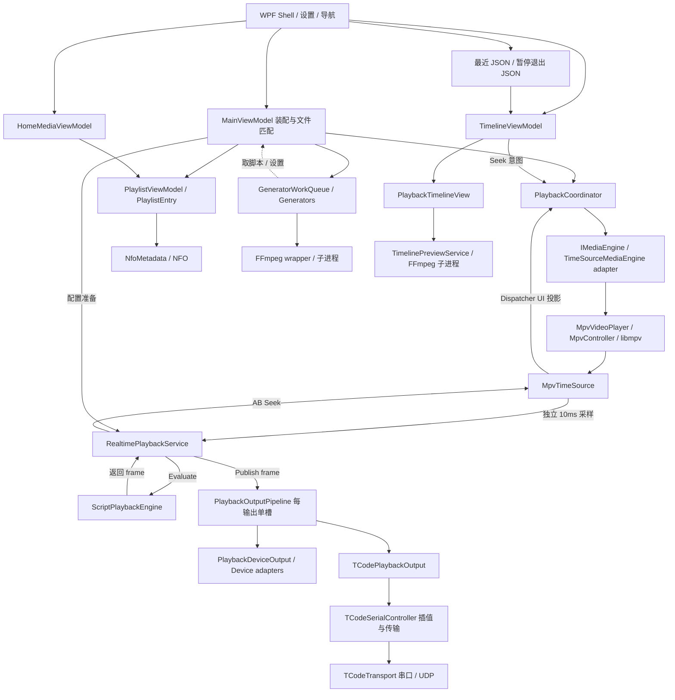
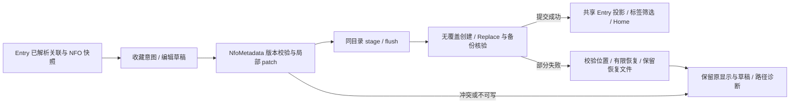

# 当前架构

核实日期：2026-10-10 接管，2026-10-11 更新 R02 与既有界面维护结果。范围是本地 `ScriptPlayer-merged`；上层工作目录含构建脚本、测试视频、net48 参考程序集、基线和历史成品，不作为第二份生产源码。文档描述当前 implementation，改进目标见 [MAINTENANCE](MAINTENANCE.md)。

## 项目与入口

| 路径 | 当前职责 |
| --- | --- |
| `ScriptPlayer/ScriptPlayer` | WPF 主应用、ViewModels、UI 投影、Playback、Generators、Metadata |
| `ScriptPlayer/ScriptPlayer.Shared` | libmpv 接入、时间源、脚本格式/原始 Handler、设备与 TCode、FFmpeg wrapper |
| `ScriptPlayer/ScriptPlayer.HandyApi` / `ScriptPlayer.Ipc` | Handy 接入与 IPC；构建主应用时引用 |
| `ScriptPlayer/MK312WifiDotNetLib` | SDK 格式 net48；本机快捷构建使用既有 DLL |
| `ScriptPlayer.Cli`、`Console`、`VideoSync`、`HandyAPIv3Playground` | 辅助工程；主应用基线不等于整个解决方案都已构建 |
| `tests` | csc 编译的独立测试程序，非 dotnet test / xUnit 工程 |
| `Themes/MediaTokens.xaml` / `MediaTheme.xaml`（主应用内） | 语义色彩、字体、间距与共享模板，详见 [DESIGN](DESIGN.md) |

`App` → `MainWindow` → `MainViewModel`。主窗口把具体视频控件注入 VM（MainWindow.xaml.cs:94–127）。VM 的 partial 改善源码导航，仍共享同一可变状态；不是职责已经全部抽离的证明。

## 主数据流

2026-10-10第一轮新增：`PlaylistViewModel.RenameCommand → RenameEntry → MainViewModel.RenameRelatedFiles → Library.RelatedFileRename`。Library无WPF依赖，interface覆盖发现/完整预检/不覆盖移动/回滚/恢复/result当前位置；磁盘成功后caller才更新Entry/选择并重检。显式APPDATA JSON保存完整映射给未来R10，本轮不迁移历史或NFO内部引用。当前main脚本及配置目录companion候选用于保守改名保护，不参与实时加载或计算。

图同时标出主要调用与数据流；脚本frame由计算器返回Realtime，再由Realtime发布到输出队列，不是计算器直接依赖输出。UI不掌握实时计算。FFmpeg不提供播放时钟；当前为直接libmpv，不是外置mpv进程。

## 播放与时间

- `PlaybackCoordinator` / `IMediaEngine`：播放、暂停、Seek、速度、音量与加载代际；记录用户暂停、拖动前的播放意图；发布 PlaybackState。TimeSourceMediaEngine 是真实 adapter，测试 FakeEngine 是第二个 adapter，seam 有实际 depth。
- `MpvVideoPlayer` 是 WPF HwndHost；`MpvController` 使用 `MpvNative` P/Invoke 加载 `libmpv-2.dll`（Shared/Controls/MpvController.cs:51–83，MpvNative.cs:63–76）。旧本地播放器等仍通过时间源接入命令路径。
- `MpvTimeSource` 有双通路（ScriptPlayer.Shared/TimeSource/MpvTimeSource.cs:25–66）：独立约 10ms 后台样本供实时路径；DispatcherClock 更新 UI 的 TimeSource 属性。后台能力不能推断给所有旧时间源。
- native FileLoaded 检查路径；终止事件缺少同等请求归属（R08）。Coordinator 的旧 Task 检查不能自动修正底层事件错归属。

## 脚本与多轴输出

- `ScriptHandler` 及格式解析保留原版行为；VM 拥有匹配、选择作者、更新 guard、章节、热力图和上传顺序（MainViewModel.cs:3996、5428）。
- `ScriptPlaybackEngine` 复制动作、二分查找，处理延迟、范围、反转等 PositionTransform 及动作时长。仍引用 ViewModels 的 PositionFilterMode 与 MPV sample 类型，不宣称完全与 UI 类型解耦。
- `RealtimePlaybackService` 固定接收 MpvTimeSource，持有当前配置与输出；根据原生样本计算和 AB 检查。UI 繁忙不应阻断已开始的计算/输出；配置准备仍可能发生在 UI。
- `PlaybackOutputPipeline` 每输出一个 worker、一个最新 pending frame；150ms 过期丢弃、generation/revision 检查、串行调用与 stop barrier。它没有把在途 I/O 变成可取消操作；关闭仍无界等待（R04）。
- 普通设备经 PlaybackDeviceOutput 输出计算后的 frame；TCodePlaybackOutput 仅传时刻、延迟、discontinuity，TCodeSerialController 对内部轴脚本再次插值。共享时钟不代表共享所有变换（R07）。
- TCode 主轴从未填充脚本开始，内嵌轴随后覆盖，后缀 companion 再覆盖（MainViewModel.cs:2662–2718）。作者脚本与多轴 companion 是不同概念，后者不能混入作者选择。
- 当前六轴 L0/L1/L2/R0/R1/R2 及扩展 V0/A0/A1/A2；25ms 限流、强制转移 I1000、正常 I50、移除轴回中。串口与 UDP 共用控制器。UDP 就绪只证明本机发送端开启，不证明硬件收到。
- Buttplug adapter 对一个 client 使用共享锁；上层每设备 worker 的隔离，不等于该 client 下真实设备的完全隔离。

## 媒体库、NFO 与运行历史

- 导入目录/M3U → VM → PlaylistViewModel.Entries → 后台加载 → 可变 PlaylistEntry → 媒体列表、主页和播放侧栏。
- VM/FileFinder 决定文件关联；PlaylistViewModel 的改名委托 RelatedFileRename 完整规划与执行（R03）。改名/移动尚未迁移运行历史（R10）。
- NfoMetadata 读取 title、originaltitle、source、type、plot、favorite、tags、scripts 等字段及别名，保存完整 DOM、实际 SidecarPath、原字节版本与原值快照。CopyForEdit 隔离可变草稿；Save 只 patch 改变的根字段，未知 XML 与未编辑 scripts 保留。DTD/外部实体禁止，未加输入大小预算。
- NFO 优先与文件同名；共享回退仍仅剥离 `-` 变体。Entry 缓存真实媒体/脚本关联；收藏 SaveEntryFavorite 和菜单编辑器使用其快照及实际 NFO，禁止在独立 NFO 删除后改写共享文件。旧文本可读但拒绝隐式写回，坏 XML/冲突/读取失败不得当作新文件覆盖。
- NFO 提交锁只覆盖元数据写入，不进入实时路径。同目录 CreateNew stage 完整写入/flush后发布；原文件 Replace + 唯一 backup，新文件 Move 无覆盖。校验原版本、已发布文件和被替换 backup；部分异常按真实磁盘状态有限恢复或报告保留路径。最终校验不是外部文件系统 CAS，也不保证断电自动恢复。
- 收藏与编辑成功后调用 PublishCommittedMetadata，按规范化 NFO 路径对共享 Entry 直接应用已提交快照；不 Reset、不重读、不排 FFmpeg。保留时长/封面/热力图/播放/脚本选择，更新标签与筛选，Home 跟随原 Entry 通知。失败保留原显示与编辑草稿，页内状态显示实际路径；提交后刷新异常明确显示已保存。
- 最近条目按路径保存 `MediaShell.json`（最多24），暂停退出点按路径保存 `PausedExitPoints.json`。不把它们合并成同一种恢复位置。明确用户暂停后正常关闭才记录；关闭顺序先记录、后释放引擎已存在。
- HomeMediaViewModel 保留原 Entry，合并批量刷新、去重和解绑；收藏最多六项，不受当前筛选影响。值得保留其 depth。
- 扫描直接修改 Entry，尚无完整请求修订发布协议（R09）。成员去重、目录枚举、全库 NFO 刷新需测量（R11）；当前没有 SQLite。

该链不依赖播放时钟、脚本计算或设备输出；后台扫描的整体发布协议仍属于 R09。

## FFmpeg 与时间轴

- 批量生成：GeneratorWorkQueue → Thumbnail/Preview/Heatmap 等 generator → FFmpeg wrapper → 子进程/文件。队列已有，默认串行；若加新队列不能解决旧进程退出协议。
- 旧 ConsoleWrapper 无界 WaitForExit/读流 Join，取消主要写 q；queue Dispose 仅 Join(200)，无法保证工作线程退出（R05）。部分生成器反向读取 MainViewModel 的脚本与 Settings。
- 按需预览：PlaybackTimelineView → TimelinePreviewService：140ms 合并、一个执行槽、24帧缓存、半秒桶、路径+大小+mtime 身份、4秒超时；后台解码并 Freeze。
- 控件显示前检查请求序号、媒体会话、路径、就绪状态、来源和可见性；移开/切换/退出取消。已有版本保护不能推断给媒体列表扫描。
- 图片用途不同：列表 gif/png、播放 thumbs、按需帧。未来统一进程生命周期和失效规则，不强行统一格式。
- TimelineViewModel 消费播放状态；窗口装配热力图、书签、AB、退出点与缩略图；实际 Seek 经过 Coordinator，标记不得通过显示交互意外写退出点。

## UI 状态与设置

导航、控件显隐、最近媒体、保存计时器和退出记录分散在 MainWindow partial；PlaybackCoordinator 提供播放状态，Timeline/Home 提供局部投影，不宣称有一个全局 UI 状态模型。

PlaybackChrome 的区域保持条件包含指针、捕获、拖动、焦点、菜单与内嵌入口。左、右、底独立显示；全屏与切页不替换播放实例。统一设置复用旧编辑器及活动 Settings；失焦、离页、集合变化提交，窗口合并保存。历史文档的“详细设置草稿/应用/撤销”已不能代表当前 implementation。

除新增四项界面偏好外，当前 Settings 通知无条件刷新实时配置（R01）；InlineDialogService 初始化的副作用早于 try/finally（R06）。基线正常路径通过不代表这两个失败协议已正确。

## 维护中的职责约束

UI 表达意图和投影；播放 module 拥有用户意图与会话；准备 module 应拥有匹配和一致配置；计算 module 应拥有明确轴策略；输出 adapter 应拥有具体传输；文件变更/元数据 module 应拥有安全提交；异步 module 应拥有修订与生命周期。

这里的 interface 是行为与顺序协议，不预先新增 C# interface。以 deletion test 决定 depth，以真实 adapters 决定 seam，以 locality/leverage 评估收益。约束与待确认策略见 [DECISIONS](DECISIONS.md)，证据和顺序见 [MAINTENANCE](MAINTENANCE.md)。

## 第二轮界面偏好与展示投影（2026-10-11）

`SettingsViewModel` 新增 InterfaceLanguage、InterfaceTheme、InterfaceAccent、EnableInterfaceAnimations；XML 中保存稳定选项值，旧设置缺项保持简体中文/深色/橙色/动画开启。未知选项规范化回默认值。`IsInterfacePreference` 是这四项共同的失效范围协议。

偏好通知 → `MainWindow.Appearance` → `AppearanceTheme` / `ChineseLocalization` / 页面 Opacity。纯外观保存调用原 `SaveSettings`；若保存窗口内同时有原播放设置变更，则仍调用 `ApplySettings`。`MainViewModel.Settings_PropertyChanged` 只对新增四项早退，其余旧设置的 R01 风险仍开放。

主题使用语义动态画刷，覆盖 Application、窗口、控件局部和未挂载的设置页资源；新建控件加载时补当前色板。视频叠加控件保留独立白色文本资源，热力图颜色和设备计算不变。动画仅浏览页、设置页的 Opacity，以及菜单 PopupAnimation，不改变布局命中或 native 视频位置。

语言层保留原字面量以支持来回切换；直接绑定、用户输入、媒体/标签/书签数据不作翻译，不改变数据 Culture。设置分类、输出源的显示值和快捷键名称分别刷新投影，保留对象、Key、Shortcut 和连接选择。时间轴仅重建合成标签，不更改 Seek、AB 或退出记录协议。

播放栏以实际父视口宽度布局，在 760 窗口展开侧栏时仍约束时间轴和设置入口。MediaSeekBar 按完整外圆半径限制端点绘制；强调色通过 Foreground 动态资源触发重绘。预览服务的请求代际、超时和缓存实现本轮不改。

R02编辑器表单与恢复提示使用独立滚动区，保存/取消位于固定底部行，避免Auto内容把操作挤出客户区；字段实例/绑定/事件保持原语义。元数据失败状态使用页面提示与编辑器txtStatus，保留实际NFO/暂存/备份路径。v1.0.12.1仅更新主应用发布身份，第三方程序集绑定不随之改变。

v1.0.12.2布局与指针调整位于PlaybackTimelineView和MainWindow.PlaybackChrome：Marker→Heat→Progress、共用横向坐标。BottomRevealHeight在播放页隐藏transport时为12DIP，与视图底部Margin/PersistentHeight同源；hidden仅真正底边展开，常驻条不作唤醒区。Compact及显示transport时为0。时间轴仍消费TimelineViewModel、原SeekBar命令与预览服务；没有更换时间源或调整设备/脚本链。

TimelineViewModel展示更新按实际引用/值变化通知，marker按Position/Kind/Label序列变化通知；相同无缓存后台recheck不会取消当前按需hover。真实cache替换及SessionInvalidated仍由既有视图清除旧请求/帧，媒体身份与请求代际守卫保持。此变更限UI投影，实时线程不引入工作。

## v1.0.12.3 私人配置边界

SettingsViewModel.FfmpegPath只供运行时定位（XmlIgnore）；FfmpegOverridePath兼容旧FfmpegPath XML节点，FfmpegDisplayPath供只读设置展示。默认bundled路径不序列化，显式override保留。

HandyDeviceId只在内存，legacy XML入口只读不写。SettingsViewModel.FromFile/Save→Settings.HandyCredentialStore→当前用户DPAPI/Private文件；先提交private，再原子替换普通XML。损坏ordinary XML仍恢复独立private值，保护位跨Duplicate保留且阻止默认覆盖；未编辑的损坏cipher同样不覆盖。两文件不是跨文件原子事务。UI PasswordBox初始化guard避免空框清除已有key；新展示/错误通知不触发Realtime重建。没有调整HandyController协议或实际输出。
